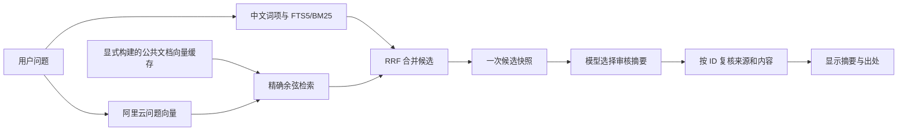

# Fitness 混合检索增强与实测

日期：2026-09-24。当前代码分支 `codex/fitness-hybrid-retrieval`，基于 `07b6ec2`；本轮直接实施 E1。未部署服务器，也未更换正在运行的服务。

最新范围：先收尾混合检索，随后按[增强路线](../../ROADMAP.md)推进记忆与受控自提升。用户质疑内部题集接近满分的代表性后，本轮保留全部原始成绩，但撤下其作为简历主要量化卖点的建议；增加外部中文检索对照，不按预设百分比挑题或调整标签。

2026-09-25 收尾补充：[外部 T2 对照](T2_RETRIEVAL_EVALUATION.md)已完成。固定 100 题/1,000 篇候选、统一预处理，原双字 Recall@6 为 72.11%，双字混合为 83.29%，jieba 混合为 84.16%，纯向量为 88.51%。保留全部五方案结果及缩小候选库的限制，不将其与内部 QA 混成一个成绩。

用户随后选择以**向量＋jieba**作为第一项增强的展示配置：在同一个固定外部对照中，相对实际旧双字方案 Recall@6 从 72.11% 到 84.16%，增加 **12.05 个百分点**；两处同时变更，不能单独归因于 jieba。可复制给 CV 助手的 [第一项 DEMO 交接](C:/Users/Gao/Desktop/RAG/fitness-agent/artifacts/learning/FITNESS_CV_ENHANCEMENT_01_HYBRID_RETRIEVAL_DEMO_2026-09-25.md)保留了所有限制。以下原始“根据实测选择配置”记录发生在这一用户偏好之前，保持历史可审计；代码默认后来已改为 `hybrid + jieba`，仍未部署。

## 做了什么

原来由相邻中文双字产生词项，SQLite FTS5/BM25 按文字匹配返回知识段落。现在增加阿里云文本向量检索，把两路各前 20 个候选用标准 RRF 合并，再取前 6 个交给原有受约束摘答。知识仍是同一批 133 个审核摘要，没有通过扩库或修改答案来制造检索提升。



向量模型直接处理原文；jieba 只用于可选的文字检索分支。FTS5 是索引与查询引擎，不是文档切段工具。现有人工 `sections` 已经承担知识分块，不额外切碎完整摘要，也没有训练自己的分词器或向量模型。

## 根据实测选择配置

比较了原双字匹配、jieba、纯向量、双字＋向量 RRF、jieba＋向量 RRF；两款真实云模型为 `qwen3.7-text-embedding` 和 `text-embedding-v4`。维度统一 1024，编码区分 `document/query`，不添加自定义指令。型号接口依据[阿里云官方文档](https://help.aliyun.com/zh/model-studio/embedding)。

先用 164 条可答 dev 题选型，于 UTC 15:30:06 写入[配置冻结记录](../../../evals/selection.json)，之后才运行 test。选择 **text-embedding-v4＋原双字 FTS5＋等权 RRF**，常数 60、各路 Top 20、回答候选 Top 6。jieba 保留为对照选项；开发集没有证明它优于原文字处理。

| dev，164 条可答题 | Recall@6 | MRR@10 |
| --- | ---: | ---: |
| 原双字 FTS5/BM25 | 99.39% | 0.9764 |
| jieba FTS5/BM25 | 98.78% | 0.9512 |
| qwen3.7 纯向量 | 99.70% | 0.9837 |
| qwen3.7＋双字 RRF | 99.70% | 0.9878 |
| qwen3.7＋jieba RRF | 100.00% | 0.9771 |
| v4 纯向量 | 99.70% | 0.9726 |
| **v4＋双字 RRF，选定配置** | **100.00%** | **0.9939** |
| v4＋jieba RRF | 100.00% | 0.9746 |

## 留出验证

内部题集共 **260 条 QA**：236 条有知识依据，24 条证据不足。覆盖 107 个知识块、88 个来源，按语义组及证据块划分；同一个知识块的改写没有混入 dev/test 两边。[题集与标注说明](../../../evals/README.md)写明 AI 拟题、参考答案来源及非穷尽相关性标注；没有包装成真实用户日志或第三方金标准。

| test，72 条可答题 | 原双字 FTS5 | 选定混合检索 | 变化 |
| --- | ---: | ---: | ---: |
| Recall@3 | 99.31% | 100.00% | +0.69 个百分点 |
| Recall@6 | 100.00% | 100.00% | 无提升 |
| MRR@10 | 0.9769 | 1.0000 | +0.0231，约相对 +2.37% |
| nDCG@10 | 0.9807 | 1.0000 | +0.0193 |

MRR 衡量首个正确资料的位置：第 1 名记 1，第 2 名记 1/2，第 3 名记 1/3，再对问题取平均。本次 3 条留出题的首个相关结果分别从第 2、3、2 名升到第 1 名。没有其他题在该指标上退步。

这批题偏容易，基线已有接近满分的表现。不能据此宣传“大幅提升召回率”或“问答准确率达到 100%”。按 11 个留出主题组做 10,000 次配对 bootstrap，MRR 差值的 95% 百分位区间为 **[0.0000, 0.0461]**；样本不足以证明对真实用户总体的稳定收益。

纯 v4 向量在该留出集的 MRR@10 也为 1.0000，因此这组数据不能证明 RRF 优于纯向量。公开集与后续自然多轮评测应继续保留这些对照。

分领域结果：训练 60 题 MRR 0.9917→1.0000；营养 12 题 0.9028→1.0000。营养留出题仅覆盖蔬果、奶类，不能外推到整个营养领域。相关块标注非穷尽，未标注的其他正确证据可能被漏算。

24 条证据不足题单独保留，不混进 Recall 分母。本次没有完成全部 260 条的真实答案质量评测，也没有统计幻觉率。检索找到近似内容并不代表这段内容足以回答问题。

[可版本化结果](../../../evals/results/fitness-2026-09-24.json)保留两模型开发集、最终留出指标、分领域结果和逐题基线/增强排名。完整运行产物位于本地 `artifacts/retrieval-eval/`。三个正式向量对照运行共 73 次请求、27,008 个供应商返回的输入 token；不含额外接口检查，实际计费以供应商账单为准。

计时是复用已生成真实问题向量后的本地检索耗时，不含网络编码，不能当成线上问答延迟。本轮没有宣称混合检索比纯文字检索更快。

## 原始问题的真实联调

使用临时测试账号、隔离数据库、真实 `text-embedding-v4` 和 `qwen3.7-plus`，从主聊天 API 走完整知识路径，未读取现有私人记录：

| 问题 | 实际状态 | 证据 |
| --- | --- | --- |
| 力量训练一般一周做几次 | answered | CDC 强化活动及 ACSM 一般编排摘要 |
| 哪些食物含蛋白质 | answered | Eatwell 蛋白质食物摘要 |
| 蛋白质一天吃多少 | insufficient | 没有用食物种类摘要冒充摄入量答案 |

合计 3 次问题编码＋3 次摘答；重复相同请求没有新增调用。它是三个问题的真实 API 检查，不是浏览器、手机、线上环境或全题集答案质量认证。[检查结果](../../../evals/results/live-chat-smoke-2026-09-24.json)。

## 工程增强与文件职责

| 文件 | 实际职责 |
| --- | --- |
| `model/embeddings.py` | DashScope 原生接口；官方地址、角色、返回序号、维度及数值校验；超时、额度回调与明确错误；不自动重试 |
| `rag/rag_service.py` | 保留基线；可选 jieba；导出有效公开知识及候选快照 |
| `rag/vector_store.py` | 独立 SQLite float32 缓存；模型/维度/端点身份、文本哈希、校验和；成功后原子发布，缓存命中免重新编码 |
| `rag/hybrid.py` | 精确余弦、标准 RRF；缓存缺失/失效或供应商失败时明确降级；调用前后核对有效来源 |
| `services/knowledge_runtime.py` | 将当前认证用户的额度检查绑定到本次查询，不用全局用户回调 |
| `services/knowledge_answers.py`、`services/coach_knowledge.py` | 一次候选快照复用；返回前按 ID 复核来源，主聊天从 3 次搜索变为 1 次；重试复用已有状态 |
| `scripts/build_knowledge_vectors.py` | 显式、有预算地构建公开文档向量；启动和在线提问不偷偷建库 |
| `scripts/evaluate_retrieval.py` | 同语料、同标签、同日期的基线和消融对照；真实向量可离线重放 |

审核过期、撤回、内容变化继续生效，不能因为旧向量还在磁盘上就返回失效知识。个人档案和记录不进入公共向量缓存。查询发送用户本次原话；不额外拼接完整档案或记录。

普通知识问题最多新增一次向量调用，再执行一次原摘答调用，均按认证用户/游客/全站额度计数。口语意图理解可能另用一次调用。缺缓存不发向量请求；额度拒绝不能被降级吞掉；禁用的旧通用 Agent 和未启用的问答不能先产生编码费用。

## 运行与回退

应用默认已改为 `hybrid + jieba`；无 Key 时明确退到 jieba 词法并保留记录流程。当前机器已经将实测的 133 条 v4 文档向量按身份和内容哈希校验后，写入默认公共缓存 `data/runtime/knowledge-vectors.sqlite3`；这一步复用了真实向量，新增云请求为 0。没有自动重启应用。

在**实际仓库根目录**，使用已安装依赖的 Python。以下命令不需要把 Key 写入命令或文件；沿用服务端已有私密环境变量：

```powershell
$env:FITNESS_RETRIEVAL_MODE = 'hybrid'
$env:FITNESS_RETRIEVAL_TOKENIZER = 'jieba'
$env:FITNESS_EMBEDDING_MODEL = 'text-embedding-v4'
$env:FITNESS_MODEL_PROVIDER = 'qwen'
$env:FITNESS_KNOWLEDGE_QA_ENABLED = 'true'
python scripts/build_knowledge_vectors.py
python scripts/build_knowledge_vectors.py --live --max-calls 50 --max-input-chars 500000
python -m uvicorn app:app --host 127.0.0.1 --port 8765 --no-access-log --no-proxy-headers
```

第一条构建命令只是检查；`--live` 才允许在缓存缺少内容时编码，默认限 50 请求/50 万字符。本机已有完整缓存时复用，不新增云请求。新机器先安装 `requirements.lock.txt`；缓存、Key 和私人库不提交 Git。旧服务占用端口时需按既有启动方式重启或换端口，不是自动发布。

本机完成 `scripts/setup.ps1` 后，可用 `scripts/start.ps1 -EnableKnowledge` 运行默认组合；启动脚本会覆盖继承的旧检索环境变量，但不会自动付费构建缺失的文档向量。无密钥时目录和查询会明确报告 `embedding_not_configured` 并退到 jieba 词法；账号与记录仍可使用。独立 `/api/agent/chat` 是旧版预览入口，仍保留词法路径，不能用它验收混合问答；用 `/api/knowledge/search`、`/api/knowledge/ask` 或主聊天知识分支验收。

回退仅把 `FITNESS_RETRIEVAL_MODE` 改回 `lexical` 后重启；私人数据结构没有变化。切换向量型号或维度须按新身份重建，不能混用已有向量。

复现实验：

```powershell
python scripts/evaluate_retrieval.py --lexical-only --split dev
python scripts/evaluate_retrieval.py --live --model text-embedding-v4 --split dev
python scripts/evaluate_retrieval.py --live --model text-embedding-v4 --split test
```

已有真实向量缓存时去掉 `--live` 可离线重放；全新模型先看 dev，再冻结配置才看 test。不要据现有 test 调参后继续称其为未见测试集。

## 简历一句话

为 Fitness 知识问答实现阿里云向量与 SQLite FTS5/BM25 的 RRF 混合检索，支持中文分词对照、版本化向量缓存、来源失效校验和明确降级，并建立可追溯评测及单次候选快照复用机制。

如需附上本轮量化，必须保留完整范围：在 T2 公开数据的固定抽样组件对照（100 题、1,000 篇候选、统一文档前 6,000 字符）中，双字词法＋向量 RRF 的 Recall@6 从原双字词法的 72.11% 提升到 83.29%，增加 11.18 个百分点；同组纯向量为 88.51%。不能省略范围改写成 Fitness 问答准确率，也不能声称融合胜过纯向量。

逐题比较中，这个融合方案相对纯向量有 0 题更好、83 题持平、17 题更差（Recall@6）。因此当前工程保留 RRF 供对照和按需使用，不能把它作为已证明的最优默认排名策略。词法兜底即使没有 RRF 融合也可独立保留；下一轮产品选型需要把纯向量作为一等候选，并用新的独立数据验证。

暂不把小样本满分或后续尚未实现的循环与自提升数字写进简历。面试时解释实际实现、对照方案和已知局限；完整公开库评测、人工盲审与线上监测尚未完成。最终代码回归见[测试结果](RETRIEVAL_TEST_RESULTS.md)。
